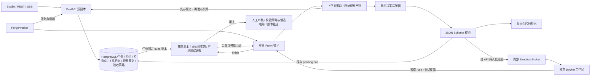

# Forge 的执行与恢复设计

核心实现位于 `forge/runtime.py`、`forge/protocol.py`、`forge/api.py`。这是项目自己实现的决策循环；模型适配器返回一个结构化动作，循环负责校验、工具路由、检查点、观察结果、预算与完成条件。旧 Codex CLI 全自动执行器保留为独立 engine，不能领取 Forge 任务。

图中的数据库箭头表示逻辑持久化，worker 实际通过 API 访问，不能直连数据库。旧 LangGraph 示例使用 Redis；Forge 队列本身由 PostgreSQL 管理，不依赖 Redis 投递。

## 为什么自己控制循环

适配器只承担 `decide(messages, schema)`。`ScriptedProvider` 用于确定性故障测试；`CodexDecisionProvider` 使用正常登录的 CLI 作为兼容桥接；`OpenAICompatibleProvider` 提供直接 HTTP 模型入口。没有模型 API key，因此当前真实模型证据来自 CLI 桥接，HTTP 适配器只有协议测试，详见 [PROVIDERS.md](PROVIDERS.md)。

默认预算为 30 次决策、每次 12,000 个上下文估算 token、累计 350,000 个已报告 input/output token、最多 2 次 finish 验收失败后的修复机会，以及任务的墙钟超时。累计 token 是调用后检查，费用可能被最后一次调用超出，但超限决策不会再派发工具。CLI 的隐藏系统提示不计入本地上下文估算。恢复沿用已持久化步数、token 预算与绝对截止时间；截止时间包含中断期间的等待，不因 resume 重置。网络中断导致供应商未返回 usage 时无法精确计算已消耗额度。模型没有返回合法结构化动作或调用内置工具时，任务明确失败。

`finish` 不能直接声明成功。循环固定调用 `run_tests`，将失败观察重新送回模型；最终 complete 接口再次在新 Docker 副本执行任务固定的独立验收策略。通过后进入 awaiting_review，人类接受才推进项目版本。没有测试命令且没有独立 suite 时，Forge 不会把空验证当成完成。

项目的 acceptance suite 作为不可变版本保存在 PostgreSQL，任务创建时固定 ID/digest。保护清单在策略发布时按当前项目文件生成，验证前比较候选文件哈希；私有测试只读挂载，固定 pytest 运行器忽略仓库配置、conftest 和 stdout 的成功声明。接受时重新计算候选内容摘要，并检查任务策略仍是项目当前策略；无 suite 的历史候选不能新接受。候选 Python 与 pytest 仍共享解释器，不提供恶意代码对评分进程篡改的完整防护。接口、版本升级和支持范围见 [独立验收设计](ACCEPTANCE.md)。

## 工具调用的故障语义

一次调用经过以下持久化顺序：

1. worker 以 CAS revision 保存 `pending={call_id,name,arguments}`。
2. API 在任务行锁内验证 owner、租约、运行状态、schema 和 call ID。
3. 将 ToolOperation 的请求摘要和 running 状态提交，再调用 Docker。
4. 将结果和 succeeded/failed 状态提交。
5. worker 写入观察结果，清除 pending 并保存新检查点。

步骤 4 到 5 之间崩溃，恢复时使用相同 call ID，API 返回已提交结果。相同 ID 搭配不同参数返回 409。步骤 3 到 4 之间崩溃，无法知道外部副作用是否完成，保留 running，拒绝自动重放；用户检查结果后发起新的 follow-up。这是已完成结果去重和不确定操作拒绝重试，不是跨数据库与 Docker 的 exactly-once 保证。

任务租约只保存哈希。失败任务显式 resume 后获得新租约，旧租约不能调用工具。resume 也遵守每身份 100 个未完成任务的限制，并检查项目版本未推进。完成、接受与源快照操作都验证状态。取消阻止后续决策；已经进入 broker 的命令可能继续运行到其超时，不能声称瞬时回滚或远程进程立即终止。

首次工作区准备另有事务级 advisory lock，外部初始化和基线测试期间不持 Task 行锁，以免长测试阻塞心跳。任务使用固定标识的初始快照保留修改前内容，基线结果与 `workspace_ready` 在重新加行锁、检查当前租约和取消状态后一起提交。旧任务若已 ready 但没有基线，不从当前可变文件伪造补录。完成流程把外部结果暂存局部变量，最后禁止自动 flush 并重新加行锁刷新控制字段，防止取消竞态或旧完成请求覆盖新租约。额外初始快照增加持久卷占用，完整生命周期清理仍待实现。

上下文观察原文存入服务端 PostgreSQL `forge_artifacts`，消息只保留受限预览和内容哈希引用。[worker](../scripts/forge_worker.py#L53) 先等待原文上传成功，再发布 observation 事件和保存 checkpoint；[checkpoint API](../src/agent_backend/forge/api.py#L61) 在行锁与 CAS 检查后验证引用确已属于该任务且元数据一致，避免发布悬空引用。新 worker 取得有效租约后只需通过 API 分页读取，不依赖旧 worker 的目录。

[artifact API](../src/agent_backend/forge/artifacts.py#L49) 同时校验 Task owner 和租约，按任务隔离内容哈希。原文不可覆盖，相同内容上传幂等；单项限制 1 MiB，每任务 16 MiB / 256 项，配额与写入在同一 Task 行锁内检查。旧版本的本地原文只有仍存在并通过哈希核对时才能迁移；原文已丢失就明确失败，不能靠摘要恢复或重新执行命令冒充原始观察。

工具原始结果仍可能同时保存在 `ToolOperation.result` 和事件 payload，事件可从 SSE 重放；当前没有消除这些副本，也没有 artifact retention / GC。实现提供跨 worker 的服务端读取协议，尚无真实多物理主机或数据库灾备证据。接口、事务顺序、测试入口与限制见 [ARTIFACTS.md](ARTIFACTS.md)。

## 代码检索与上下文

代码按有重叠的窗口切片；Python 使用标准库 AST 提取符号，JS/TS 采用声明识别。BM25 内容得分结合路径、符号得分排序，返回路径、行号、快照版本和文件摘要。修改后下一次检索重新建立索引，避免把旧版本命中当成当前源码。没有 embedding 或向量数据库依赖；目前是词法检索，不声称语义 RAG。

ContextBuilder 保留系统规则、任务需求和完整的工具调用/结果组，超预算时移除旧组并加入有界的确定性摘要。大观察保存为可分页读取的 artifact。估算采用 UTF-8 字节启发式，不是供应商 tokenizer。循环检测结合相同工具参数和相同观察，避免把每次读取内容已变化的文件误判为死循环。

模型的 action summary 同时保存为最多 2000 字符的工作笔记，记录已确认事实、定位和下一步；下一次决策把它作为明确标注“不可信、需以新观察复核”的 user 消息纳入同一上下文预算，检查点恢复也保留它。工作笔记是模型生成的，和历史裁剪时的确定性摘要分开；它不能作为验收证据或高优先级指令。这个改动来自一次反复读取源码直到触发预算的实际失败，尚不能用单次重试证明其普遍收益。

检索消融使用固定的独立相关性标签，比较 naive path、纯 lexical、hybrid。小型合成回归集不能外推到大型真实仓库，也不能在两个方法得分相同时声称 hybrid 更优。

## 并发、隔离和当前限制

API 无状态，任务通过 PostgreSQL `FOR UPDATE SKIP LOCKED` 领取。每身份 admission advisory lock 原子控制未完成数量；Executor 行的 upsert 锁串行化同一执行器容量检查。100 是当前队列上限，实际默认执行器容量是 2，Docker broker 另有容量限制。增加 worker 不会自动增加模型额度或容器资源。

Forge 的读写代码、命令和测试均在 Docker 中执行；Windows worker 只管理模型决策、索引和 HTTP。容器使用非 root、无网络、只读根目录、受限 CPU/内存/PID，Git 基线只读。固定验收命令运行在临时复制卷，测试副作用不改变审核产物。

当前面向个人和可信团队：Docker 共享宿主内核、持久卷没有磁盘硬配额、没有完整恶意多租户隔离；只有 bearer 身份而非企业用户/组织 RBAC。初始仓库受归档大小和文件数量限制；命令运行环境需预装依赖。真实模型评测目前仅是两条历史 bug 的 pilot，存在训练数据污染可能，不是 SWE-bench 分数。

源码、检索片段和工具输出标记为不可信数据，模型动作必须通过 schema 校验且在沙箱允许的能力范围内执行。这些措施限制影响范围，不证明模型不会服从恶意内容；目前没有真实模型提示注入攻击集，也没有完整防任务偏离的保证。具体 bad case、处理证据及尚未解决的追问见 [面试讨论](INTERVIEW.md)。

## 复用与项目自己的工作

复用 Aegra/FastAPI 的服务框架、SQLAlchemy/PostgreSQL、Docker、现有 Codex 身份与模型能力。项目实现的是 Coding API 与状态机、独立沙箱 broker、模型单步协议与循环、版本化检索、上下文管理、持久化操作/恢复协议、工作台，以及独立历史 issue 评测器。`mini-swe-agent` 等开源项目是设计参考；不能把基础模型或上游框架能力算作本项目自研成果。
